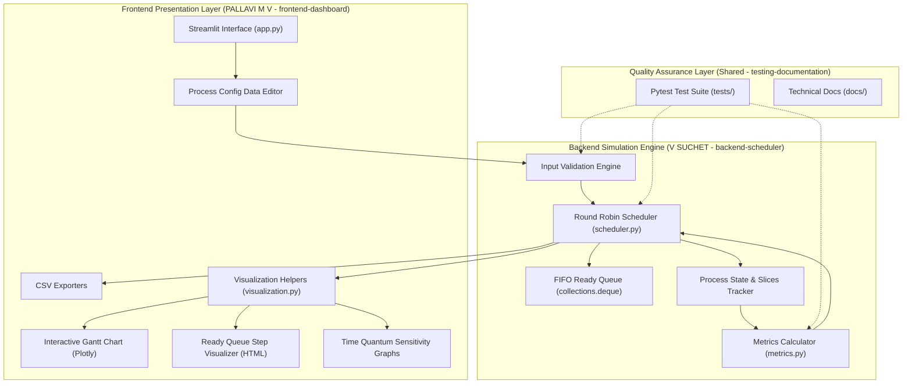
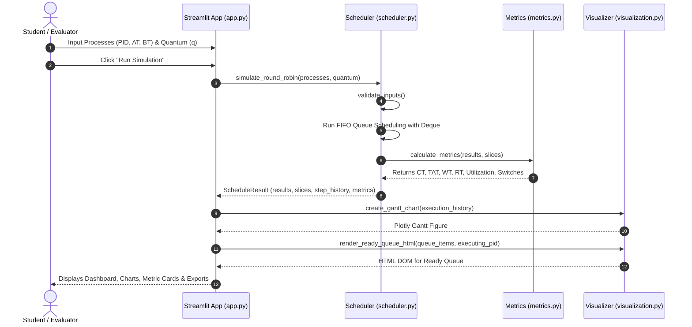

# System Architecture Documentation

**Project**: Round Robin CPU Scheduling Simulator  
**Course**: Operating Systems Group Mini-Project (Two-Member Team)  
**Authors**: V SUCHET (Backend Engineer) & PALLAVI M V (Frontend Engineer)  

---

## 1. Overview & Architectural Principles

The Round Robin CPU Scheduling Simulator is architected with a strict **Separation of Concerns (SoC)** model. The computational scheduling logic is fully decoupled from the presentation and user interface layers. This decoupled architecture allows:
- **Independent Testing**: The backend scheduling engine can be unit-tested without launching a web server or graphical interface.
- **Clear Team Division**: Backend development (`V SUCHET`) and Frontend development (`PALLAVI M V`) proceed simultaneously on dedicated Git branches without merge conflicts.
- **Extensibility**: The simulation engine can be plugged into a CLI, REST API, or desktop GUI without altering the scheduling algorithms.

---

## 2. High-Level Architecture Diagram



---

## 3. Data Flow Model

The end-to-end simulation flow follows this sequence:



---

## 4. Module Specifications

### 4.1 Backend Modules (`backend-scheduler` Branch)

#### `scheduler.py`
- **`Process`**: Value object encapsulating process metadata (`pid`, `arrival_time`, `burst_time`, `priority`).
- **`_ProcessRuntimeTracker`**: Stateful internal engine tracking remaining burst time, first CPU dispatch time, and completion timestamps.
- **`validate_inputs(processes, quantum)`**: Defensive validation preventing negative times, non-positive burst times, non-positive quantum, and duplicate PIDs.
- **`simulate_round_robin(processes, quantum) -> ScheduleResult`**: Main deterministic execution loop using `collections.deque`. Captures execution slices, idle periods, and step-by-step queue snapshots.

#### `metrics.py`
- **`calculate_metrics(processes, execution_history) -> Dict[str, Any]`**: Computes:
  - Completion Time (CT), Turnaround Time (TAT), Waiting Time (WT), Response Time (RT).
  - Average Waiting Time, Turnaround Time, and Response Time.
  - Total CPU Busy Time, Total CPU Idle Time, Total Elapsed Time.
  - CPU Utilization percentage.
  - Context switch counts (differentiating inter-process context switches vs. consecutive slices of the same process).

---

### 4.2 Frontend Modules (`frontend-dashboard` Branch)

#### `visualization.py`
- **`create_gantt_chart(execution_history) -> go.Figure`**: Renders an interactive Plotly horizontal bar chart representing CPU occupancy with idle regions and hover details.
- **`create_process_metrics_chart(processes) -> go.Figure`**: Multi-metric grouped bar charts for per-process TAT, WT, and RT.
- **`create_quantum_comparison_charts(comparison_df) -> Tuple[go.Figure, go.Figure]`**: Scatter and bar plots illustrating the trade-off between quantum size, turnaround time, and context switch counts.
- **`render_ready_queue_html(queue_items, executing_pid) -> str`**: Custom HTML/CSS component illustrating CPU execution and the FIFO queue front-to-rear order.

#### `app.py`
- Interactive Streamlit dashboard featuring:
  - Dark-mode responsive aesthetic with custom CSS.
  - Interactive process table editor with presets (Section 11 sample, simultaneous arrivals, CPU idle gaps).
  - Metric summary cards (Avg WT, Avg TAT, Avg RT, CPU Utilization, Context Switches).
  - Step-by-step time slider for inspecting ready queue transitions.
  - Time quantum sensitivity analysis module.
  - One-click CSV export utilities for scheduling tables, execution intervals, and comparison benchmarks.

---

## 5. Interface Contract

The contract between V SUCHET and PALLAVI M V is defined through Python data classes in `scheduler.py`:

```python
@dataclass
class ProcessResult:
    pid: str
    arrival_time: float
    burst_time: float
    completion_time: float
    turnaround_time: float
    waiting_time: float
    response_time: float
    first_start_time: float

@dataclass
class ExecutionSlice:
    pid: str
    start_time: float
    end_time: float
    duration: float
    is_idle: bool = False

@dataclass
class SimulationStep:
    step_number: int
    time: float
    executing_pid: str
    duration: float
    remaining_burst: float
    ready_queue_before: List[str]
    ready_queue_after: List[str]
    event_description: str
    completed: bool

@dataclass
class ScheduleResult:
    processes: List[ProcessResult]
    execution_history: List[ExecutionSlice]
    step_history: List[SimulationStep]
    total_time: float
    metrics: Dict[str, Any]
    quantum: float
```
